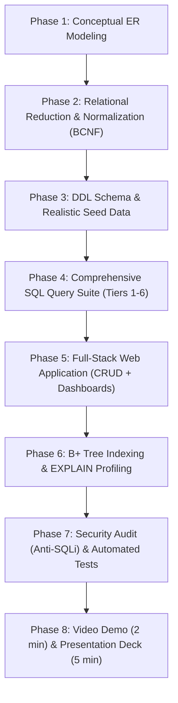

# HKU COMP3278A — Final Project Master Blueprint & Specifications

> **Course:** HKU COMP3278A — Introduction to Database Management Systems  
> **Instructor:** Dr. CHEN, Yi (chenyi1@hku.hk) | School of Computing & Data Science, HKU  
> **Target Deliverable:** Production-Ready Relational Database, Full-Stack Web Application, Comprehensive Query Portfolio, 2-Minute Video Demo, and 5-Minute Final Presentation.  
> **Repository:** `uffe0520/DBMS_Final_Project`

---

## 1. Executive Summary & Problem Context

The official tutorial document (`tutorial_final_project.pdf`) provides a basic, high-level walkthrough of building a simple food delivery app with generic CRUD functionality using GitHub Copilot. However, relying solely on basic CRUD (`INSERT`, `SELECT *`, `UPDATE`, `DELETE`) is **insufficient** to achieve high academic marks in COMP3278A.

To achieve top marks (A / A+), this project must systematically demonstrate mastery of **all core course learning outcomes**:
1. **Information Modeling (E-R Model):** Rigorous conceptual modeling capturing complex business rules, cardinalities, weak entity sets, total/partial participation, and ISA specialization hierarchies.
2. **System Design & Normalization:** Formal reduction of E-R diagrams to relational tables, functional dependency analysis, and proof of Boyce-Codd Normal Form (BCNF) or Third Normal Form (3NF).
3. **Advanced Querying (SQL & Relational Algebra):** Execution of complex relational queries, multi-table joins, aggregations with `GROUP BY` and `HAVING`, correlated subqueries (`EXISTS`, `NOT EXISTS`), universal set comparisons (`>= ALL`), set operations (`UNION`, `INTERSECT`, `EXCEPT`), and database views.
4. **Physical Optimization & Storage (Indexing):** Strategic index creation (B+ Trees) with verified query plan speedups using `EXPLAIN`.
5. **Cybersecurity & Application Development:** Full-stack integration with strict defense against SQL injection via parameterized queries / prepared statements.

---

## 2. Course Syllabus & Learning Outcome Mapping

| Course Chapter | Syllabus Topic | Required Project Implementation |
| :--- | :--- | :--- |
| **Ch 1: Introduction** | 3-Tier Architecture, Data Independence, DBMS Engine | Clean separation: Database Engine (MySQL 8.x) $\leftrightarrow$ Backend API (Node.js/Python/Go) $\leftrightarrow$ Frontend UI (React/Vite/Next.js/Tailwind). |
| **Ch 2: E-R Model** | Entities, Relationships, Weak Entities, ISA, Keys | Chen notation diagram + Crow's foot diagram with explicit cardinalities (arrows $\to$ 1 side), double-line participation, discriminators, and specialization. |
| **Ch 3: SQL** | DDL, Constraints, Joins, Aggregation, Subqueries, Views | Production schema script (`schema.sql`), rich seed data (`data.sql`), 15+ advanced queries spanning basic CRUD to universal quantification. |
| **Ch 4: Relational Algebra** | $\sigma, \pi, \times, \bowtie, \bowtie_\theta, -, \cup, \div, \mathcal{G}$ | Formal mathematical Relational Algebra expressions documented for all core analytical and business-critical queries. |
| **Ch 5: Database Design** | Functional Dependencies, Closures, 3NF / BCNF | Formal decomposition proof showing all relation schemas satisfy BCNF (or 3NF with dependency preservation) with zero update anomalies. |
| **Ch 6: Indexing** | B+ Tree Indexes, Clustered/Secondary Indexes | Strategic `CREATE INDEX` statements on high-frequency search/join columns; performance benchmarks before & after using `EXPLAIN`. |
| **Ch 7: SQL Injection** | Vulnerabilities, Threat Models, Prepared Statements | 100% parameterized queries in the application layer; automated security test demonstrating resistance to `' OR 1=1 --` attacks. |

---

## 3. Recommended Project Domain: Multi-Vendor Food & Delivery Ecosystem

While groups may choose any complex domain (e.g., Steam, Instagram, Spotify, Airbnb), the **Multi-Vendor Food & Logistics Platform (Keeta / Deliveroo / UberEats style)** is strongly recommended because it naturally incorporates all required relational complexities:

### Core Entities & Relationships
1. **Users & ISA Specialization:**
   - Superclass: `User` (`user_id`, `email`, `password_hash`, `name`, `phone`, `role`, `created_at`)
   - Subclasses (Disjoint, Total):
     - `Customer` (`customer_id`, `delivery_address`, `default_payment_method`)
     - `RestaurantOwner` (`owner_id`, `business_registration_no`)
     - `Driver` (`driver_id`, `vehicle_type`, `license_plate`, `status`)
2. **Restaurants & Branches (Hierarchical Relationship):**
   - `Restaurant` (`restaurant_id`, `name`, `cuisine_type`, `address`, `parent_chain_id` [self-referencing FK])
   - Multi-valued attribute reduced table: `RestaurantTag` (`restaurant_id`, `tag_name`)
3. **Menu Items & Categories (1:N, Category Hierarchy):**
   - `MenuCategory` (`category_id`, `restaurant_id`, `category_name`, `display_order`)
   - `MenuItem` (`item_id`, `restaurant_id`, `category_id`, `name`, `description`, `price`, `is_available`)
4. **Orders & Order Items (Weak Entity / Composition):**
   - `Order` (`order_id`, `customer_id`, `restaurant_id`, `driver_id`, `order_status`, `delivery_fee`, `total_amount`, `placed_at`)
   - `OrderItem` (Weak Entity depending on `Order`): (`order_id`, `item_id`, `quantity`, `unit_price_at_purchase`)
5. **Coupons & Promotions (N:M Relationship):**
   - `Coupon` (`coupon_code`, `discount_percent`, `min_spend`, `valid_until`)
   - `OrderCoupon` (`order_id`, `coupon_code`, `discount_applied`)
6. **Reviews & Ratings (Multi-party Interaction):**
   - `Review` (`review_id`, `order_id`, `customer_id`, `restaurant_id`, `rating`, `comment`, `created_at`)

---

## 4. The 8-Phase Engineering & Academic Roadmap

### Phase 1: Conceptual ER Modeling
- **Deliverables:**
  - `docs/er_diagram_chen.png` (Formal Chen notation as taught in Lecture 2).
  - `docs/er_diagram_crows_foot.png` (Modern relational notation).
  - `docs/er_design_notes.md` explaining every cardinality constraint, participation constraint, weak entity discriminator, and ISA hierarchy.
- **Course Pitfalls to Avoid (from `cheatseet1.pdf`):**
  - *Arrow Direction:* Arrows point **TO the "1" side** (`Post` $\to$ `User`).
  - *Weak Entities:* Never draw the owner's primary key as an ellipse on the weak entity; use double diamond and dashed underline for discriminators.
  - *Attributes on Relationships:* Attributes depending on combination of entities (e.g. `unit_price_at_purchase`, `delivery_fee`, `rating_time`) must live on the relationship diamond.

### Phase 2: Relational Reduction & Normalization Proofs
- **Deliverables:**
  - `docs/relational_schemas.md` containing formal relational notation with primary keys underlined and foreign keys italicized.
  - `docs/normalization_proofs.md`:
    - List of all non-trivial Functional Dependencies ($X \to Y$) for every relation.
    - Identification of Candidate Keys via attribute closure ($X^+$).
    - Step-by-step verification demonstrating all tables satisfy BCNF (or 3NF where dependency preservation is required).

### Phase 3: Physical DDL Schema & Seed Data Generation
- **Deliverables:**
  - `sql/01_schema.sql`: Complete DDL with data types, `PRIMARY KEY`, composite keys, `FOREIGN KEY ... REFERENCES ... ON DELETE CASCADE / SET NULL`, `CHECK` constraints, `UNIQUE`, and `DEFAULT`.
  - `sql/02_seed_data.sql`: Rich, realistic synthetic data (at least 20+ users, 10+ restaurants, 50+ menu items, 100+ orders, realistic status distributions).
  - `sql/00_reset_db.sql`: Clean teardown and rebuild script.

### Phase 4: Core & Advanced SQL Query Portfolio
- **Deliverables:**
  - `sql/03_queries.sql`: Containing at least 15 distinct, documented queries matching the 6-Tier requirements defined in `SQL_RULES.md`:
    - **Tier 1:** Standard CRUD endpoints.
    - **Tier 2:** Multi-table joins (3+ tables) with outer joins.
    - **Tier 3:** Aggregations with `GROUP BY` and `HAVING` filters.
    - **Tier 4:** Nested subqueries with correlated `EXISTS`, `NOT EXISTS`, and set comparisons (`>= ALL`, `IN`).
    - **Tier 5:** Relational division ("Find customers who have ordered from ALL Japanese restaurants").
    - **Tier 6:** Analytical Views (`CREATE VIEW`) for business dashboards.
  - Formal Relational Algebra expressions written alongside key queries.

### Phase 5: Full-Stack Web Application
- **Deliverables:**
  - Modern web application (e.g. Next.js / React frontend + Node.js / FastAPI backend).
  - Clean UI workflows:
    - User/Restaurant authentication & profile.
    - Interactive menu browsing, search, and filtering (using backend SQL).
    - Order creation flow (transactional: creates `Order` + multiple `OrderItem` rows).
    - Live order status update & driver assignment.
    - Admin / Analytics Dashboard displaying live SQL aggregations, top restaurants, and revenue trends.

### Phase 6: Indexing & Performance Tuning
- **Deliverables:**
  - `sql/04_indexing.sql`: Explicit `CREATE INDEX` statements targeting foreign keys and high-cardinality search/filter fields (e.g. `order_status`, `placed_at`, `cuisine_type`).
  - `docs/performance_report.md`: Before-and-after query execution plans using `EXPLAIN ANALYZE` demonstrating index scan improvements.

### Phase 7: Cybersecurity Audit & Automated Testing
- **Deliverables:**
  - Zero raw string concatenation in backend database queries.
  - Proof of parameterized query usage across all routes.
  - End-to-end integration tests (`tests/`) verifying database constraints and API endpoints.

### Phase 8: Final Presentation & Moodle Submission Package
- **Deliverables:**
  - `presentation/slides.pdf`: 5-minute presentation slides structured according to professor guidelines:
    1. Project introduction & motivation (1 slide).
    2. Comprehensive ER diagram walkthrough (1-2 slides).
    3. Relational Schema & Normalization highlights (1 slide).
    4. Key SQL queries & architecture (1-2 slides).
    5. Team member contributions (every member speaks).
  - `presentation/demo_video.mp4`: Crisp, high-definition video demonstration ($\le$ 2 minutes) with audio voiceover showing all representative functions.
  - `README.md`: Complete setup manual allowing TAs to clone, seed, and launch the application locally in under 3 minutes.

---

## 5. Milestone Deadlines & Schedule

| Milestone | Target Completion Date | Status / Responsible |
| :--- | :--- | :--- |
| **M1: Repository & Framework Setup** | Today (Oct 26) | Complete (`uffe0520/DBMS_Final_Project`) |
| **M2: ER Diagram & Relational Schemas** | Nov 2 | Phase 1 & 2 Complete |
| **M3: SQL Schema, Seeds & Query Suite** | Nov 9 | Phase 3 & 4 Complete |
| **M4: Web Application CRUD & Dashboards** | Nov 16 | Phase 5 Complete |
| **M5: Indexing, Security Audit & Testing** | Nov 19 | Phase 6 & 7 Complete |
| **M6: 2-Min Demo Video & Slides** | Nov 21 | Phase 8 Complete |
| **M7: Final Presentation & Submission** | Nov 23 – Nov 25 | In-Class Presentation & Moodle Submission |

---

## 6. Definition of Done (A+ Quality Gate)

A task is only marked **DONE** when:
- [ ] Schema passes `FOREIGN KEY` checks without orphan records.
- [ ] Every relation schema is mathematically proven to be in BCNF (or 3NF).
- [ ] All 6 Tiers of SQL queries are tested against realistic seed datasets.
- [ ] No SQL queries use raw string interpolation (100% prepared statements).
- [ ] Application runs seamlessly from a single launch command (`npm run dev` or `docker compose up`).
- [ ] README contains reproducible setup instructions tested on a clean machine.
