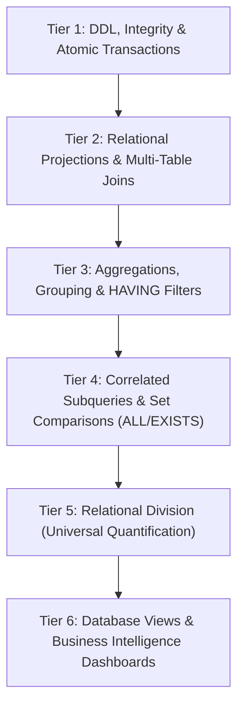

# SQL_RULES.md — Comprehensive SQL Command Matrix & Syllabus Coverage

> **Course:** HKU COMP3278A — Introduction to Database Management Systems  
> **Source Syllabus:** Chapters 1–4, plus Ch 5 (Normalization), Ch 6 (Indexing), and Ch 7 (SQL Injection).  
> **Purpose:** Authoritative specification of all mandatory database commands, relational algebra formalisms, and query tiers that MUST be demonstrated in the final project.

---

## 1. Overview & Pedagogical Philosophy

To earn full marks in the HKU COMP3278A final project evaluation, the project cannot simply execute trivial single-table queries. The database schema and application queries must demonstrate deep theoretical understanding and practical execution across **all 6 Tiers of Relational Querying**, together with physical indexing, transaction safety, and cybersecurity defenses.

---

## 2. The 6-Tier Query Command Matrix



---

### Tier 1: Data Definition (DDL), Integrity Constraints & Transactions

All relation schemas must be created via structured DDL scripts enforcing strict relational constraints.

#### Required DDL Features:
- **Table Creation & Mutation:** `CREATE TABLE`, `DROP TABLE IF EXISTS`, `ALTER TABLE`.
- **Primary Keys:** Single-attribute and composite primary keys (`PRIMARY KEY (order_id, item_id)`).
- **Foreign Keys & Referential Integrity Actions:**
  - `FOREIGN KEY (...) REFERENCES ... (...) ON DELETE CASCADE ON UPDATE CASCADE`
  - `FOREIGN KEY (...) REFERENCES ... (...) ON DELETE SET NULL`
  - `FOREIGN KEY (...) REFERENCES ... (...) ON DELETE RESTRICT`
- **Domain & Column Constraints:** `NOT NULL`, `UNIQUE`, `DEFAULT <value>`, `CHECK (<condition>)`.

#### Required Transaction Control (ACID):
Operations modifying multiple tables (e.g. placing an order) must be wrapped in atomic transactions:
```sql
START TRANSACTION;
INSERT INTO orders (customer_id, restaurant_id, total_amount, order_status)
VALUES (?, ?, ?, 'PENDING');

SET @new_order_id = LAST_INSERT_ID();

INSERT INTO order_items (order_id, item_id, quantity, unit_price_at_purchase)
VALUES (@new_order_id, ?, ?, ?);

UPDATE coupons
SET usage_count = usage_count + 1
WHERE coupon_code = ?;

COMMIT;
-- ROLLBACK; on error
```

---

### Tier 2: Relational Projections, Filtering & Multi-Table Joins

Demonstrates standard relational algebra operations ($\sigma, \pi, \times, \bowtie$).

#### Required Syntax Elements:
- **Projection & Aliasing:** `SELECT col1, col2 AS alias FROM ...`
- **Complex WHERE Filtering:**
  - Comparisons: `=`, `<>`, `<`, `>`, `<=`, `>=`
  - Boolean connectives: `AND`, `OR`, `NOT`
  - Range & Set: `BETWEEN ... AND ...`, `IN (...)`
  - Pattern matching: `LIKE '%pattern%'`, `LIKE '_single_char%'`
  - Three-valued logic & NULLs: `IS NULL`, `IS NOT NULL`
- **Join Mechanisms:**
  - **Comma Join (Cartesian Product + Theta Join):**
    ```sql
    SELECT C.name, O.order_id
    FROM customers C, orders O
    WHERE C.customer_id = O.customer_id AND O.total_amount > 200.00;
    ```
  - **Explicit Inner Join:** `FROM orders O INNER JOIN restaurants R ON O.restaurant_id = R.restaurant_id`
  - **Left Outer Join:** Display all entities even if they have zero children (e.g., all restaurants including those with 0 orders placed):
    ```sql
    SELECT R.restaurant_id, R.name, COUNT(O.order_id) AS total_orders
    FROM restaurants R
    LEFT JOIN orders O ON R.restaurant_id = O.restaurant_id
    GROUP BY R.restaurant_id, R.name;
    ```
  - **Self-Join (Hierarchical Relations):**
    ```sql
    -- Joining restaurants to their parent chain headquarters
    SELECT branch.name AS branch_name, parent.name AS chain_headquarters
    FROM restaurants branch
    JOIN restaurants parent ON branch.parent_chain_id = parent.restaurant_id;
    ```
  - **Multi-Way Joins:** Queries spanning $\ge$ 4 tables simultaneously (`users`, `orders`, `order_items`, `menu_items`, `restaurants`).

---

### Tier 3: Aggregation, Grouping & Partition Filtering

Demonstrates relational aggregation ($\mathcal{G}$).

#### Required Syntax Elements:
- **Aggregate Functions:** `COUNT(*)`, `COUNT(col)`, `COUNT(DISTINCT col)`, `SUM(col)`, `AVG(col)`, `MIN(col)`, `MAX(col)`.
- **Grouping:** `GROUP BY attribute1, attribute2`.
- **Group Filtering (`HAVING`):**
  - Filtering on aggregates (e.g. restaurants having average rating $\ge 4.5$ and more than 10 reviews):
    ```sql
    SELECT R.restaurant_id, R.name, AVG(RV.rating) AS avg_rating, COUNT(RV.review_id) AS review_count
    FROM restaurants R
    JOIN reviews RV ON R.restaurant_id = RV.restaurant_id
    GROUP BY R.restaurant_id, R.name
    HAVING COUNT(RV.review_id) >= 10 AND AVG(RV.rating) >= 4.5
    ORDER BY avg_rating DESC, review_count DESC;
    ```

---

### Tier 4: Correlated Subqueries & Set Comparisons (`ALL`, `EXISTS`)

Demonstrates advanced relational query logic without relying on window functions.

#### Required Syntax Elements:
1. **Universal Extremal Comparison (`>= ALL`):**
   - Find the single or tied customers who spent the absolute maximum total amount across the system:
   ```sql
   SELECT C.customer_id, U.name, SUM(O.total_amount) AS total_spent
   FROM customers C
   JOIN users U ON C.customer_id = U.user_id
   JOIN orders O ON C.customer_id = O.customer_id
   GROUP BY C.customer_id, U.name
   HAVING SUM(O.total_amount) >= ALL (
       SELECT SUM(O2.total_amount)
       FROM orders O2
       GROUP BY O2.customer_id
   );
   ```
   > ⚠️ **Syllabus Pitfall Warning (from `cheatseet1.pdf`):** When computing global maximums, do NOT copy outer where clauses into the inner `ALL` subquery unless computing a strictly conditioned local maximum!

2. **Correlated Subqueries with `EXISTS` & `NOT EXISTS`:**
   - Find drivers who have never had a cancelled order:
   ```sql
   SELECT D.driver_id, U.name
   FROM drivers D
   JOIN users U ON D.driver_id = U.user_id
   WHERE NOT EXISTS (
       SELECT 1
       FROM orders O
       WHERE O.driver_id = D.driver_id AND O.order_status = 'CANCELLED'
   );
   ```

3. **Subqueries in the `FROM` Clause (Derived Tables):**
   - Course-compliant alternative to CTEs (`WITH` clauses):
   ```sql
   SELECT T.cuisine_type, AVG(T.restaurant_revenue) AS avg_cuisine_revenue
   FROM (
       SELECT R.restaurant_id, R.cuisine_type, SUM(O.total_amount) AS restaurant_revenue
       FROM restaurants R
       JOIN orders O ON R.restaurant_id = O.restaurant_id
       GROUP BY R.restaurant_id, R.cuisine_type
   ) AS T
   GROUP BY T.cuisine_type;
   ```

---

### Tier 5: Relational Division (Universal Quantification)

Demonstrates the relational division operator ($R \div S$).

#### Project Query Requirement:
- **Business Question:** *"Find all VIP customers who have ordered from EVERY Japanese restaurant registered in the platform."*
- **SQL Implementation (Double `NOT EXISTS` pattern):**
```sql
SELECT C.customer_id, U.name
FROM customers C
JOIN users U ON C.customer_id = U.user_id
WHERE NOT EXISTS (
    -- Set of all Japanese restaurants:
    SELECT R.restaurant_id
    FROM restaurants R
    WHERE R.cuisine_type = 'Japanese'
    AND NOT EXISTS (
        -- Check if customer ordered from this restaurant:
        SELECT 1
        FROM orders O
        WHERE O.customer_id = C.customer_id
          AND O.restaurant_id = R.restaurant_id
    )
);
```
- **Alternative Implementation (`COUNT(DISTINCT)` with Subquery):**
```sql
SELECT O.customer_id, U.name
FROM orders O
JOIN users U ON O.customer_id = U.user_id
JOIN restaurants R ON O.restaurant_id = R.restaurant_id
WHERE R.cuisine_type = 'Japanese'
GROUP BY O.customer_id, U.name
HAVING COUNT(DISTINCT R.restaurant_id) = (
    SELECT COUNT(*) FROM restaurants WHERE cuisine_type = 'Japanese'
);
```

---

### Tier 6: Database Views & Business Intelligence Dashboards

Demonstrates view creation, abstraction, and role-based security.

#### Required Views:
1. `view_restaurant_performance`: Aggregating total revenue, completed order count, and average customer rating per restaurant.
2. `view_daily_sales_analytics`: Daily breakdown of gross merchandise value (GMV), net sales, delivery fees, and discount totals.
3. `view_driver_leaderboard`: Driver fulfillment count, average delivery duration, and tips.

```sql
CREATE OR REPLACE VIEW view_restaurant_performance AS
SELECT 
    R.restaurant_id,
    R.name AS restaurant_name,
    R.cuisine_type,
    COUNT(DISTINCT O.order_id) AS total_orders,
    COALESCE(SUM(O.total_amount), 0.00) AS total_revenue,
    ROUND(AVG(RV.rating), 2) AS average_rating
FROM restaurants R
LEFT JOIN orders O ON R.restaurant_id = O.restaurant_id AND O.order_status = 'DELIVERED'
LEFT JOIN reviews RV ON R.restaurant_id = RV.restaurant_id
GROUP BY R.restaurant_id, R.name, R.cuisine_type;
```

---

## 3. Relational Algebra Formalization Catalog

Every primary analytical query in the project portfolio must include its formal mathematical Relational Algebra expression:

| Operation | Formal Relational Algebra Expression |
| :--- | :--- |
| **Selection** | $\sigma_{\text{status} = \text{'DELIVERED'} \land \text{total} > 150}(\text{Orders})$ |
| **Projection** | $\pi_{\text{user\_id}, \text{name}, \text{email}}(\text{Users})$ |
| **Natural Join** | $\text{Orders} \bowtie \text{Customers}$ |
| **Theta Join** | $\text{Orders} \bowtie_{\text{Orders.restaurant\_id} = \text{Restaurants.restaurant\_id}} \text{Restaurants}$ |
| **Set Difference** | $\pi_{\text{customer\_id}}(\text{Customers}) - \pi_{\text{customer\_id}}(\text{Orders})$ |
| **Division** | $\pi_{\text{customer\_id}, \text{restaurant\_id}}(\text{Orders}) \div \pi_{\text{restaurant\_id}}(\sigma_{\text{cuisine} = \text{'Japanese'}}(\text{Restaurants}))$ |
| **Aggregation** | $_{\text{restaurant\_id}}\mathcal{G}_{\text{COUNT}(\text{order\_id}) \to \text{num\_orders}, \text{SUM}(\text{total}) \to \text{rev}}(\text{Orders})$ |

---

## 4. Physical Optimization: B+ Tree Indexing Rules (Ch 6 Syllabus)

To satisfy the Database Indexing requirement:
1. Identify high-frequency join columns and search predicates (`WHERE`, `ORDER BY`).
2. Add explicit B+ Tree indexes in `sql/04_indexing.sql`:
   ```sql
   -- Indexing foreign keys for rapid join lookups:
   CREATE INDEX idx_orders_customer ON orders(customer_id);
   CREATE INDEX idx_orders_restaurant ON orders(restaurant_id);
   CREATE INDEX idx_order_items_item ON order_items(item_id);

   -- Composite index for status-filtered date-range queries:
   CREATE INDEX idx_orders_status_date ON orders(order_status, placed_at);
   ```
3. Profile queries using `EXPLAIN ANALYZE`:
   - Capture the execution plan before indexing (demonstrating full table scan: `type: ALL`).
   - Capture the execution plan after indexing (demonstrating index range scan: `type: ref` or `type: range`).
   - Include these query plan diffs in the project report and presentation slides!

---

## 5. Cybersecurity: SQL Injection Defense Rules (Ch 7 Syllabus)

To satisfy the SQL Injection & Database Security requirement:
1. **Threat Model:** Explain how unsanitized input allows attackers to manipulate SQL syntax:
   - Example Exploit: `' OR '1'='1' --` bypassing authentication.
   - Example Exploit: `1; DROP TABLE orders; --` destructive multi-query execution.
2. **Mandatory Defense Implementation:**
   - 100% of queries in application code must use prepared statements with variable binding (`?` placeholders).
   - Backend database connection pool must be configured with `multipleStatements: false`.
   - Implement an automated security test in `tests/security.test.ts` proving that malicious payload inputs are safely escaped and treated as literal values.

---

## 6. Strictly Forbidden / Disallowed Features (Academic Standard)

Directly sourced from [`AGY.md`](file:///Users/nr1/Documents/HKU/DBMS/AGY.md) and [`Assignment2/AGY.md`](file:///Users/nr1/Documents/HKU/DBMS/Assignment2/AGY.md): The COMP3278A syllabus specifically restricts certain modern and vendor-specific SQL extensions in academic submissions to evaluate foundational relational algebra competence.

| Forbidden Feature | Why It Is Disallowed | Required Course Alternative |
| :--- | :--- | :--- |
| ❌ **Common Table Expressions (`WITH ... AS (...)`)** | CTEs bypass raw relational algebra nested query evaluations. | Use **derived tables in the `FROM` clause** (`(SELECT ...) AS t`) or subqueries in `HAVING` / `WHERE`. |
| ❌ **Window Functions (`OVER()`, `RANK()`, `ROW_NUMBER()`)** | Not part of basic relational calculus/algebra. | Use **correlated subqueries** (e.g. `COUNT(*) WHERE val > outer.val`) or self-joins to rank/partition. |
| ❌ **Procedural SQL (Stored Procedures, Triggers, Cursors, Loops, UDFs)** | Procedural constructs hide relational logic from the query optimizer. | Implement business workflows in **pure declarative SQL + application service layer** with transactions. |
| ❌ **Non-standard `LIMIT` for Extremal Queries** | Relying on `ORDER BY val DESC LIMIT 1` avoids demonstrating universal set comparisons. | Use **`>= ALL (SELECT ...)`**, `= (SELECT MAX(...) FROM ...)`, or `NOT EXISTS` to solve maximums/minimums. |
| ❌ **Dynamic Date Functions in Formal Queries (`NOW()`, `CURDATE()`)** | Dynamic timestamps cause test suites to fail depending on execution time. | Use **fixed date/timestamp literals** (e.g. `'2026-08-01'`) for reproducible grading evaluation. |

